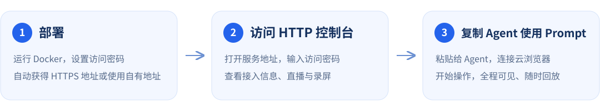

# cloudbrowser

**让 AI 操作浏览器，实时直播、全程录屏，操作过程看得见。** 通过 MCP 将远程浏览器接入 AI Agent；打开控制台、输入访问密码，即可复制接入信息。

实例创建时可指定 UA、页面视口、HTTP/SOCKS5 鉴权代理、语言与时区；支持点击、输入、iframe、多标签页、上传下载、截图及诊断。

## 使用流程



## 快速部署

### 最少输入：只设密码，自动获得 HTTPS

无需域名、Cloudflare 账号或端口映射。先改密码，再运行：

```sh
docker run -d --init \
  --name cloudbrowser \
  --restart unless-stopped \
  --shm-size=1g \
  -e WEB_PASSWORD='替换为你的强密码' \
  -v browser-mcp-data:/data \
  bdpgogoup/cloudbrowser:20261021091630
```

查看自动生成的 HTTPS 地址：

```sh
docker logs cloudbrowser
```

日志中的 `Public HTTPS URL` 就是控制台地址。打开后输入密码，复制 MCP 接入信息。MCP 地址、直播及录屏分享地址全部自动使用该 HTTPS 地址。

此模式使用匿名 Cloudflare Quick Tunnel；容器重新创建隧道后地址会变化，旧 MCP 和分享 URL 需更新。它适合试用和临时测试，没有可用性保证，最多200个进行中的请求，不支持 SSE。本服务 MCP 使用 JSON 响应，网页直播使用逐帧 JPEG 刷新。[Cloudflare 官方限制](https://developers.cloudflare.com/tunnel/get-started/quick-tunnels/)

### 固定 HTTPS：只增加一个 Tunnel Token

先在 Cloudflare 创建一个命名隧道并添加自己的公开域名，服务目标填写 **HTTP → localhost:8080**，保存并复制该隧道的连接器 Token。首次绑定域名后，容器重启继续使用相同域名；子域名可以在首次配置时自行随机命名。

部署时只需密码和 Token：

```sh
docker run -d --init \
  --name cloudbrowser \
  --restart unless-stopped \
  --shm-size=1g \
  -e WEB_PASSWORD='替换为你的强密码' \
  -e CF_TUNNEL_TOKEN='替换为隧道的连接器Token' \
  -v browser-mcp-data:/data \
  bdpgogoup/cloudbrowser:20261021091630
```

服务自动读取隧道配置，识别唯一指向本容器端口的域名，无需再填 `BASE_URL`。如果配置了多个符合条件的域名、通配符或路径规则，请增加 `-e BASE_URL=https://browser.example.com` 明确选择地址。只支持 Cloudflare 远程管理的命名隧道，不会代替用户购买域名或创建 DNS。

Token 通过子进程环境传递，不出现在命令行参数、网页、MCP 返回值或普通日志中。Cloudflare 的连接器 Token 与本服务的 MCP Token 是两种独立凭据。

### 已有域名或反向代理：指定 BASE_URL

显式设置 `BASE_URL` 且不设置 `CF_TUNNEL_TOKEN` 时，使用部署方提供的地址，不启动内置隧道：

```sh
docker run -d --init \
  --name cloudbrowser \
  --restart unless-stopped \
  --shm-size=1g \
  -p 8080:8080 \
  -e BASE_URL=http://localhost:8080 \
  -e WEB_PASSWORD='替换为你的强密码' \
  -v browser-mcp-data:/data \
  bdpgogoup/cloudbrowser:20261021091630
```

部署到远程服务器时，将 `BASE_URL` 改为实际可访问地址；部署方负责 DNS、反向代理、HTTPS 或端口映射接通容器8080。`BASE_URL` 可带路径前缀。

### 使用步骤

1. 打开 `BASE_URL`，输入 `WEB_PASSWORD`。
2. 点击 **复制 Agent 接入信息**，粘贴给 Agent。也可单独复制 MCP JSON 配置。
3. Agent 配置远程 MCP 后，先调用 `health`，再创建和控制浏览器实例。
4. 在网页“实时实例”中选择实例观看直播；关闭实例后，在“历史录屏”播放录像。

复制内容采用简短格式：一句话、MCP 地址、认证请求头和一个公开文档链接。文档由当前部署提供，无需登录，包含完整接口参考与 Agent 操作流程，与镜像内的文档版本一致。

```text
请接入以下远程浏览器 MCP，先阅读公开文档并发现可用工具，再按我的要求操作浏览器。
MCP（Streamable HTTP）：https://browser.example.com/mcp
认证请求头：Authorization: Bearer <自动生成的Token>
公开文档：https://browser.example.com/docs/agent-guide.md
```

公开文档仅提供通用说明；真实 Token 仍通过登录后的复制操作获取。复制内容包含服务访问凭据，请只交给可信使用方。

控制台使用 React + Ant Design，包含工作台、实时实例、历史录屏、代理管理、MCP 接入和文档中心，并适配手机屏幕。所有前端资源随镜像打包，不依赖外部 CDN。

不需要 SSH 配置或 Chrome 插件。原 stdio / SSH 接入方式仍保留。

## MCP 地址与鉴权

- 地址：`BASE_URL/mcp`
- 协议：**Streamable HTTP**，不是旧 SSE。
- 鉴权：`Authorization: Bearer <自动生成的 Token>`。
- Token 在第一次部署时生成并保存到数据卷。密码与 Token 分开，Token 不在 URL 查询参数中。
- 同一数据卷、同一密码重启后 Token 保持不变；更换 `WEB_PASSWORD` 并重启会轮换 Token，使旧配置失效。
- 登录 Cookie 为 HttpOnly、SameSite=Strict，默认有效 24 小时；服务重启后需重新登录。

登录页可获取的通用配置示例：

```json
{
  "mcpServers": {
    "cloudbrowser": {
      "type": "http",
      "url": "https://browser.example.com/mcp",
      "headers": { "Authorization": "Bearer <网页自动生成>" }
    }
  }
}
```

Agent 必须支持远程 Streamable HTTP MCP 及自定义 Authorization 请求头。不同客户端的配置文件格式可能不同；网页提供服务地址、请求头、通用 JSON 和完整接口说明供 Agent 适配。

本版本是单管理员服务。网页可以查看全部实例；HTTP MCP 调用共享 `web` principal。Token 可控制浏览器并读取录像，请只交给可信 Agent。外网部署使用 HTTPS，避免密码、Token 与浏览器内容以明文传输。

## 创建指定环境

`create_instance` arguments 示例：

```json
{
  "user_agent": "Mozilla/5.0 (Linux; Android 14; Pixel 8) AppleWebKit/537.36 (KHTML, like Gecko) Chrome/130.0.0.0 Mobile Safari/537.36",
  "viewport": { "width": 412, "height": 915 },
  "mobile": { "enabled": true, "touch": true, "device_scale_factor": 2 },
  "locale": "en-US",
  "timezone": "America/New_York",
  "proxy": {
    "server": "socks5://proxy.example.com:1080",
    "username": "your-user",
    "password": "your-password"
  }
}
```

- 每个实例独立浏览器进程和会话；新标签页继承同一代理和设备环境。
- 支持 `http://`、`https://` 上游与 `socks5://`，凭据通过独立字段传入。
- 省略 proxy 是明确的直连模式；指定代理失败不会回退直连。
- 环境参数创建后固定，切换环境需新建实例。
- UA 示例仅展示配置，不代表当前真实浏览器版本。Client Hints、页面布局和真机可能不同。
- viewport 是 CSS 像素的设备视口；移动页面没有 viewport meta 时，layout_viewport 可能约为 980px。
- 返回 instance_id、初始 page_id 和实际设备属性。用 `verify_environment` 验证出口，不把配置的国家标签当作真实地区。

`verify_environment` 默认访问第三方 `https://api.ipify.org?format=json`，可传自己的 `check_url`。地区数据库未内置。

## 直播和录像

默认参数：

| 项目 | 默认 |
| --- | --- |
| 采样帧率 | 2 FPS |
| 最大画面 | 640 × 480，保留比例，录像留黑边 |
| JPEG 质量 | 40 |
| 录像 | VP9 WebM，无音频 |
| 单实例录像上限 | 128 MiB |
| 历史录像总配额 | 1 GiB |
| 保留时间 | 7 天 |

控制台和公开观看页使用逐帧 JPEG 刷新（最多约2 FPS），兼容 Cloudflare 的流式缓冲。另保留 MJPEG 媒体接口供直接连接使用；多个观看者共享同一份实例采样，不重复启动浏览器或截图任务。实例内新页面和最近操作的页面成为活动页面，直播和录像随之切换；不会同时录制所有标签页。

历史录像支持浏览器播放和 Range 请求。正常关闭实例会完成录像；异常终止会标记为 interrupted，残留文件不保证完整可播。达到单段大小上限后停止录像，直播仍可继续。采样或编码拥塞时可能丢帧，录像时长可能短于真实执行时长；这是低负载过程留证，不是精确时间审计。

录像会包含浏览器中可见的输入与业务内容。通过 `RECORD_VIDEO=false` 可关闭历史录像，实时预览仍可用。产物和录像保存在 `/data`，需挂载数据卷。

## 公开直播与录像分享

Agent 可通过 MCP 创建无需登录的只读观看链接；链接使用 `BASE_URL`，支持部署路径前缀。观看者只能看到指定实例的活动页面或指定录像，不能操作浏览器或访问控制台。

直播（实例运行中调用）：

```json
{"kind":"live","instance_id":"ins_...","expires_in_seconds":3600}
```

录像（先 `close_instance`，再用 `list_recordings` 找到 `recording_id`）：

```json
{"kind":"recording","recording_id":"rec_...","expires_in_seconds":86400}
```

以上为 `create_share_link` 的 arguments。成功返回 `share_id`、`url`（观看页）、`media_url`（MJPEG 或 WebM）、直播的 `frame_url`（单帧 JPEG）、`expires_at`。把 `url` 直接发给观看者即可，手机和桌面浏览器均可打开，录像支持播放、拖动和下载。

- 有效期默认 24 小时，可设 1 秒至 30 天；最多 1000 个有效分享。
- `list_share_links {}` 查询当前 principal 的分享元信息；链接秘密仅在创建结果中返回，可用该次 `get_operation` 找回尚未从内存淘汰的结果。
- `revoke_share_link {"share_id":"shr_..."}` 撤销；后续访问立即拒绝，已连接直播在 1 秒内断开。已下载或已缓冲的画面无法收回。
- 直播结束后显示已结束，不会自动开放录像；录像需独立创建分享。未完成或文件为空的录像不能分享。
- 分享授权保存在 `/data/shares.json`，仅存随机密钥的 SHA-256 摘要。同一数据卷重启后仍有效；修改管理密码不会撤销分享，请按需显式撤销。
- 分享到期不延长录像保留时间。录像被配额或保留期清理后，观看页显示不可用。新建分享时自动清除过期或已撤销的分享元信息。
- 链接本身就是观看凭证，持有者无需密码。分享前确认画面可公开；链接不包含管理员 MCP Token，不提供浏览器操作权限。

纯 stdio 模式（`WEB_PORT=0`）无法提供公开观看链接。反向代理需要允许 `/share/` 路径，并对直播关闭缓冲。

## 并发与运行配置

**默认最多 10 个并发浏览器实例**，超过直接返回 `INSTANCE_LIMIT`，不无限排队。可通过 `-e MAX_INSTANCES=5` 等修改。上限不是预分配数量，建议先在实际网站上测量内存；10 个实例应预留相应服务器资源。

| 环境变量 | 默认 | 说明 |
| --- | --- | --- |
| `BASE_URL` | 自动识别 | 自定义外部地址；普通部署必填，匿名隧道不填，命名隧道可省略 |
| `CF_TUNNEL_TOKEN` | 空 | 远程管理命名隧道的连接器 Token；填后自动启用固定域名模式 |
| `CF_QUICK_TUNNEL` | 自动 | 没有 BASE_URL / CF_TUNNEL_TOKEN 时开启匿名隧道；设 false 可禁止自动隧道 |
| `CF_TUNNEL_STARTUP_TIMEOUT_MS` | 60000 | 隧道启动等待时间，100–180000 毫秒 |
| `CLOUDFLARED_PATH` | cloudflared | 镜像内置固定版本的 cloudflared，可指定可执行路径 |
| `WEB_PASSWORD` | 必填 | 网页访问密码，不写入普通日志 |
| `WEB_PORT` | 8080 | 容器 HTTP 端口；设为 0 可用纯 stdio 模式 |
| `MAX_INSTANCES` | 10 | 最大并发实例数，1–100 |
| `MAX_PAGES` | 10 | 每实例最大页面数 |
| `ACTION_TIMEOUT_MS` | 15000 | 默认工具/导航超时 |
| `RECORD_VIDEO` | true | 是否保存历史录像 |
| `VIDEO_FPS` | 2 | 1–10 FPS |
| `VIDEO_WIDTH` / `VIDEO_HEIGHT` | 640 / 480 | 低清视频画面边界，建议使用偶数值 |
| `VIDEO_QUALITY` | 40 | JPEG 质量，10–80 |
| `FFMPEG_PATH` | ffmpeg | 编码程序路径；Docker 内已安装 |
| `MAX_RECORDING_BYTES` | 134217728 | 单段录像大小上限 |
| `MAX_RECORDINGS_BYTES` | 1073741824 | 历史录像总配额 |
| `MAX_DOWNLOAD_BYTES` | 52428800 | 下载及单产物大小限制 |
| `MAX_DATA_BYTES` | 1073741824 | 截图/下载等产物配额，不含录像 |
| `MAX_LOG_BYTES` | 16777216 | 诊断事件轮转总大小，不含最多1000份实例快照 |
| `LOG_RETENTION_HOURS` | 168 | 诊断事件和结束实例状态的最长保留时间 |
| `ARTIFACT_RETENTION_HOURS` | 168 | 产物及历史录像保留时间 |
| `PROXY_CONFIG` | /config/proxies.json | 首次启动时导入的代理文件 |
| `PROXY_CHECK_INTERVAL_SECONDS` | 300 | 自动检测周期，秒；30–86400 |
| `PROXY_CHECK_URL` | https://api.ipify.org?format=json | 检测目标，遵循目标访问策略 |
| `DATA_DIR` | /data（Docker） | 数据存储位置 |
| `ALLOWED_HOSTS` | 空 | 可选目标白名单，逗号分隔，支持 *.example.com |
| `ALLOW_PRIVATE_NETWORKS` | false | 显式允许内网测试，会扩大访问范围 |
| `CHROMIUM_SANDBOX` | false | 是否启用 Chromium sandbox，需宿主配套配置 |

Web 模式始终要求 WEB_PASSWORD。自动隧道失败时会退出，不会回退为无密码服务。隧道进程意外退出会使服务退出，交由 Docker 的重启策略恢复；匿名模式恢复后地址可能改变。隧道需要出站 HTTPS 和 TCP 7844 连通；无需开放入站端口。CF_QUICK_TUNNEL=true 与 BASE_URL / CF_TUNNEL_TOKEN 互斥。命名隧道可设置 BASE_URL 覆盖自动域名识别。普通自管模式下，BASE_URL 不替代实际网络配置。

对于路径前缀，反向代理可保留或剥离该前缀，页面链接均使用配置的外部前缀。反向代理需保留客户端 Origin，且 MJPEG 直播路由禁用缓冲（Nginx 可设 `proxy_buffering off`），MCP 路由需允许 POST 并配置足够超时。

## 代理管理与 HTTP 请求

登录控制台，打开 **代理管理**，点击 **添加代理**。填写服务器 IP / 域名、端口，选择国家 / 地区，填写用户名和密码；默认 SOCKS5，也支持 HTTP / HTTPS。名称可不填，默认使用服务器地址。支持编辑、启停、删除和复制完整代理 ID；密码按明文显示。列表默认每页20条，ID 中间省略、名称不重复显示国家，支持按关键词、国家、状态和协议筛选。

配置保存在 `/data/proxies.json`，使用数据卷即可在重建容器后保留。国家是手动标记，不代表系统已验证出口地理位置；“启用”表示允许被选用，与检测状态分开。修改、停用或删除代理只影响新的浏览器和 HTTP 请求，已运行实例保留原有配置。

服务启动后立即检测已启用代理，之后默认每5分钟自动检查；新增、修改连接信息或重新启用时也会检查。最多并行3个检测，不启动浏览器、不占浏览器实例名额。通过代理请求检测目标，2xx 视为本次连通成功；网络、超时或非2xx 返回异常。状态包括正常、异常、待检测、检测中、已停用；悬停可查看耗时、时间、错误码和可识别的出口IP。可点击“立即检测”重新检查。失败不自动停用，也不回退直连。检测仅反映到指定目标的最近一次结果，不能保证其他网站可用或国家正确。

检测结果单独保存在 `/data/proxy-health.json`，配置保存在原 `/data/proxies.json`；重启保留历史并重新检查，超过两个周期的结果视为待检测。修改、删除或停用期间返回的旧检测结果不会覆盖新配置。检测缓存损坏会重新检测，不会阻止服务启动。

Agent 调用 `list_proxies` 查询列表，可传 `country: "US"`、`protocol: "socks5"`、`status: "healthy"`；默认仅返回启用项，不会自动排除异常项以保持兼容。返回 ID、名称、地址、国家、鉴权标记、status 和 health（时间、耗时、失败码等），不返回用户名或密码。然后按 ID 创建实例：

```json
{"proxy_id":"proxy_由平台生成的ID","viewport":{"width":390,"height":844}}
```

也可以直接调用 **`proxy_curl`**，通过同一个代理发送 HTTP 请求，无需启动浏览器：

```json
{"proxy_id":"proxy_由平台生成的ID","url":"https://api.ipify.org?format=json"}
```

可指定 `method`、`headers`、UTF-8 `body`、`follow_redirects`、`timeout_ms`、`max_bytes` 和 `response_encoding`（text / base64）。返回状态码、响应头、响应体、最终 URL 和耗时。默认 GET、15 秒、64 KiB、不跟随跳转；最长60秒、最大响应1 MiB、最多5次跳转，请求体最多64 KiB。HTTP 4xx/5xx 原样返回状态码；网络失败和超限返回工具错误。不会执行 Shell、自动重试或在代理失败后直连。请求可能已到达目标，写请求超时后应确认状态再重试。

目标遵循 `ALLOWED_HOSTS` 和内网访问限制，跳转目标也经过代理网关检查。HTTP 请求并发上限与 `MAX_INSTANCES` 相同，但不占浏览器实例名额。响应可能包含目标站点的敏感信息，按需要使用并保存；诊断日志不记录请求头、请求体和响应体。

原内联 `proxy` 参数和 `proxy_ref` 仍兼容，与 `proxy_id` 三选一。可选挂载旧配置：

```sh
--mount type=bind,src=/srv/browser-mcp/proxies.json,dst=/config/proxies.json,readonly
```

仅当数据卷尚无代理配置时，首次启动会导入 `PROXY_CONFIG`（格式见 `config/proxies.example.json`），保留原引用作为代理 ID；之后以控制台中的配置为准，无需修改挂载文件。配置文件需要可被容器非 root 用户读取。

## 上传下载、诊断与操作状态

- 下载自动捕获：`list_downloads` → `wait_for` → `get_artifact` 分块获取并校验 SHA-256。
- 上传：`put_artifact` 接收授权文件的 base64（最多 512 KiB），`upload_file` 上传到 file input；不接受任意宿主路径。
- `snapshot` 返回页面结构和原始 DOM 节点引用，页面变化后重新读取。
- `get_diagnostics` 查询脱敏跳转和请求失败，`screenshot` 保存截图。
- 超时或断连后用 `list_operations` / `get_operation` 确认状态，不盲目重复提交。
- `list_recordings` 返回当前 principal 的历史录像及带路径的 playback_url，获取时仍需 Bearer 鉴权。

工具执行成功不等于业务流程通过；实际测试标准由 Skill 决定。

## MCP 日志与故障排查

`get_logs` 查询脱敏的持久化事件，`inspect_instance` 查询当前或历史实例状态。实例关闭、浏览器崩溃、管理进程重启后，只要保留 `/data` 且记录未被清理，仍可排查；新日志能力无法补回升级前未记录的证据。

卡住时先调用 `inspect_instance`：

```json
{"instance_id":"ins_...","probe":true,"timeout_ms":1500}
```

它绕过实例执行锁，返回正在执行的操作及耗时、浏览器连接、进程退出码/信号、关闭原因、最后画面时间、采样和编码器状态、资源信息及最近告警。探测只执行固定的只读响应性检查，最长5秒，不会自动取消、重试或关闭任务。

按实例查看异常事件，`level=warn` 包含 warn 和 error：

```json
{"instance_id":"ins_...","level":"warn","limit":100}
```

以上是 `get_logs` 的 arguments。也可不传实例查询最近事件，或用 `operation_id`、`component`、`since`、`after_seq` 筛选。`since` 使用带时区的 ISO8601 时间；返回 `next_after_seq`，下次传为 `after_seq` 可增量读取，`has_more=true` 时继续翻页。

能够区分的证据包括：

- 正常关闭、空闲超时 `idle_timeout`、最大存活期 `max_lifetime`、服务关闭 `service_shutdown`。
- 浏览器断开、主进程退出码/信号、页面崩溃、操作超时和长时间未完成。
- 截图采样失败/恢复、编码器不可用/退出、编码拥塞和录像配额。
- 管理进程事件循环延迟、容器内存压力、cgroup OOM 计数变化、数据卷剩余空间。

**SIGKILL、断开连接或探测超时本身不能证明 OOM。** 资源信息缺失时返回 null；历史实例中的故障与当前容器的资源计数也可能不属于同一次运行。需要结合事件时间、宿主机和容器证据判断。

日志默认保留7天、最多约16 MiB，分4段轮转；实例状态最多保留1000个结束记录。高频页面事件超过队列上限会丢弃并通过 `dropped_events` 明确报告，避免日志本身拖垮服务；`write_errors` / `last_write_error` 报告存储故障。历史被轮转或过期清理后无法补回。

日志不记录认证头、Cookie、请求/响应正文、输入内容和原始 console 文本；保留错误类型、HTTP状态、网络错误码及脱敏URL。MCP仅能查询当前 principal 的实例事件和通用服务事件，不接受任意服务器文件路径。公开分享链接和公开文档不能访问日志。

服务或容器整个不可用时，MCP也无法响应。请先在服务器上保留以下输出，再恢复服务：

```sh
docker logs --since 30m --tail 200 cloudbrowser
docker inspect --format 'oom={{.State.OOMKilled}} exit={{.State.ExitCode}} restarts={{.RestartCount}} error={{.State.Error}}' cloudbrowser
```

不要用完整 `docker inspect` 输出替代上述摘要，完整输出可能包含部署环境中的密码和Token。

## 发布镜像

发布目标固定为 **Docker Hub `bdpgogoup/cloudbrowser`**。标签为 `YYYYMMDDHHMMSS`，默认上海时区。脚本默认构建并推送 amd64 / arm64 两个平台，不发布 latest 别名。

```sh
# 先预览，不构建、不登录、不推送
bash scripts/publish-docker.sh --dry-run
# 使用本机已登录 bdpgogoup 的 Docker 凭据发布
docker login --username bdpgogoup
bash scripts/publish-docker.sh
```

可通过 `DOCKERHUB_TOKEN` 环境变量让脚本自动以 bdpgogoup 登录，Token 使用 password-stdin，不打印。支持 `PLATFORMS`、`RELEASE_TZ` 和 `RELEASE_TAG`（14位时间标签）覆盖。脚本依赖 Docker Buildx；不在代码或镜像中保存账号密码。发布时自动将 README 部署示例更新为本次实际 tag，成功后输出镜像名和可复制的分行部署命令；发布失败时恢复原 tag。

## 源码构建及 stdio 接入

```sh
docker build -t cloudbrowser:0.8.0 .
```

将一行部署命令最后的镜像名换成 `cloudbrowser:0.8.0` 即可本地使用。

兼容配置见 [本地 stdio](examples/mcp.local.json)、[SSH stdio](examples/mcp.ssh.json)。仍使用 `docker exec -i`，不得使用 `-t`。MCP_PRINCIPAL 是可信 SSH/Docker 接入中的命名空间，不是独立认证。

## 开发与验证

前端源码位于 `web/`，使用 React + Ant Design。`npm run build` 同时进行类型检查、构建服务端和打包前端（含 gzip 资源）；Docker 镜像只需运行编译产物。

需要 Node.js 22+、FFmpeg、curl，以及 Playwright Chromium：

```sh
npm ci
npx playwright install --with-deps chromium
npm run format:check
npm test
npm run schema
```

本地纯 stdio：

```sh
WEB_PORT=0 DATA_DIR=./data MCP_SOCKET=/tmp/browser-mcp-dev.sock node dist/cli.js daemon
```

另一个终端：

```sh
MCP_SOCKET=/tmp/browser-mcp-dev.sock npm run smoke
```

容器验证：`npm run smoke -- --docker`。HTTP、直播和录屏验证：`SMOKE_BASE_URL=http://localhost:8080 SMOKE_PASSWORD=你的测试密码 npm run smoke:http`。可选 `SMOKE_URL` 做实际导航验证。

## 访问边界

默认阻止私有/保留 IP、非 HTTP(S) 目标，网关检查请求和直连 DNS。可信上游代理的远端 DNS 行为仍需信任；严格防旁路要求配置网络层防火墙。不要将应用层检查或浏览器 flags 当作完整隔离。

非 root 运行不代表 Chromium sandbox 已启用；测试不可信网站需配置 sandbox/seccomp。不会自动安装应用、执行下载文件、绕过验证码或启动定时 Agent。定时任务由独立 Agent 调度器负责。

文档：[MCP 接口](docs/mcp-api.md) · [工具 Schema](docs/mcp-tools.json) · [Agent 流程](docs/agent-workflow.md) · [验证记录](docs/validation.md)。[V1 需求草案](docs/requirements-v1.md) 为历史设计，以当前文档与实现为准。
